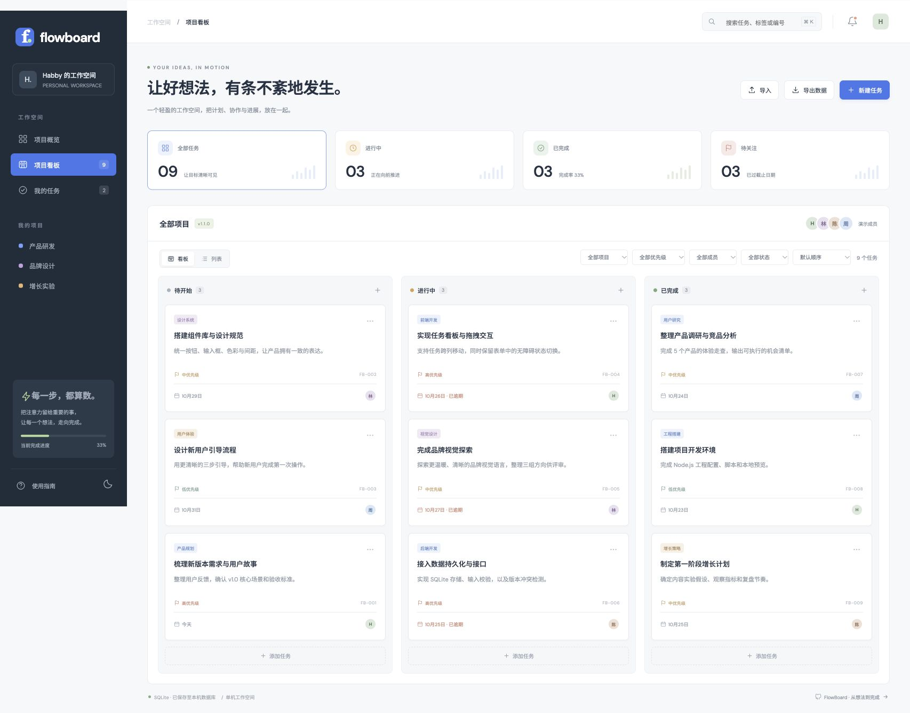

# FlowBoard

**A small project board with real persistence, thoughtful interactions, and a complete development workflow.**

一个把想法、任务和进展放在一起的轻量看板。Node.js + SQLite 完整本地服务，以及可独立部署的浏览器演示版。

[](https://github.com/Habby-me/flowboard-demo/actions/workflows/ci.yml)
[](https://github.com/Habby-me/flowboard-demo/actions/workflows/pages.yml)
[](LICENSE)
[](https://nodejs.org/)

[在线体验](https://habby-me.github.io/flowboard-demo/) · [功能与版本](CHANGELOG.md) · [架构说明](docs/ARCHITECTURE.md) · [贡献指南](CONTRIBUTING.md) · [后续计划](docs/ROADMAP.md)



## Why this project

FlowBoard 用一个小而完整的产品练习真实开发流程：任务增删改查、前后端共用校验、数据恢复、并发写入冲突、回归测试和自动发布。保持零第三方运行依赖，让代码和取舍容易阅读。

## Quick start

需要 Node.js **22.13+**，推荐 Node **24 LTS**。无需安装依赖，也不需要 API Key。

```bash
git clone https://github.com/Habby-me/flowboard-demo.git
cd flowboard-demo
npm start
```

打开 [http://127.0.0.1:3000](http://127.0.0.1:3000)。首次启动会生成 `data/flowboard.sqlite` 并写入 9 条演示任务。后续重启保留数据。

```bash
npm run dev            # 文件变化时重启本地服务
npm run preview        # 静态预览，数据保存在浏览器
npm run verify         # 语法检查 → 自动测试 → 静态构建
npm run test:coverage  # 模型、存储和接口的覆盖率报告
npm run build          # 生成可独立托管的 dist/
PORT=3001 npm start    # 端口已占用时使用其他端口
```

## Features

- **任务管理**：创建、编辑、删除、撤销删除，桌面拖拽或键盘修改状态。
- **找到重点**：按项目、成员、优先级、状态或逾期筛选；支持标题、描述、标签和编号搜索。
- **自选顺序**：截止日期、优先级、创建时间排序；记住列表/看板视图和排序偏好。
- **真实统计**：项目进度、完成率和逾期统计都来自任务数据；统计卡片可直接筛选。
- **备份恢复**：JSON 导入导出、版本校验、按编号合并、总量限制和上一份有效浏览器快照。
- **日常体验**：响应式布局、明暗主题、快捷键、操作记录和基本无障碍支持。

快捷键：`⌘ / Ctrl + K` 搜索，`N` 新建任务，`Esc` 关闭弹窗。手机端可在任务编辑窗口切换状态。

## Two storage modes

| | SQLite 本地服务 | 浏览器 / 在线演示 |
| --- | --- | --- |
| 启动方式 | `npm start` | `npm run preview` / 托管 `dist/` |
| 保存位置 | 本机 `data/flowboard.sqlite` | 当前浏览器 localStorage |
| 刷新保留 | 是 | 是 |
| 写入冲突 | 版本号检测，冲突返回 409 | 标签页同步，无跨标签页事务 |
| 恢复方式 | 导入 JSON 备份 | 导入 JSON 或恢复有效快照 |

这两种模式不会自动共享数据。浏览器清除站点数据会删除本地任务和快照，请定期导出备份。头像与负责人是演示角色；当前没有多人登录、跨设备共享或实时协作。

## Architecture

```text
app.mjs       界面、事件和存储模式选择
model.mjs     前后端共用校验、筛选、排序、备份处理
storage.mjs   浏览器持久化与恢复快照
server.mjs    Node.js HTTP 服务、SQLite 和版本冲突检测
build.mjs     清理并生成 dist/ 静态产物
test.mjs      模型、存储和 HTTP 集成测试
.github/      CI、部署、Issue 与 PR 模板
docs/         架构、路线和界面截图
```

[架构说明](docs/ARCHITECTURE.md) 包含模式选择、数据写入路径和设计边界。后端使用 Node.js 自带的 `node:sqlite`，部分 Node 版本会显示实验性提示。

## API

- `GET /api/board` → `{ tasks, revision }`
- `PUT /api/board`，请求体 `{ tasks, expectedRevision }` → `{ revision }`
- 校验失败返回 `400`，版本冲突返回 `409`，超过 2 MB 返回 `413`。
- 一个工作空间最多 500 项任务；导入和 API 使用同一套校验。

服务只监听本机回环地址，静态资源采用白名单，任务文本在渲染前转义，SQL 使用参数化语句。它尚不具备面向公网的身份认证和授权能力。更多信息见 [安全说明](SECURITY.md)。

## Development & deployment

每次 PR 和主分支更新通过 GitHub Actions 检查 Node.js **22.13** 与 **24** 的兼容性；主分支部署工作流再次验证代码并发布静态演示到 GitHub Pages。徽章展示工作流实际状态。

首次启用部署时，在仓库 **Settings → Pages → Source** 选择 **GitHub Actions**。部署产物只包含 `dist/`，不包含数据库、测试记录、凭据或服务端源码。

欢迎使用 [Issue 模板](https://github.com/Habby-me/flowboard-demo/issues/new/choose) 描述问题，或按 [贡献指南](CONTRIBUTING.md) 提交改进。版本变化见 [CHANGELOG](CHANGELOG.md)，未实现的功能见 [Roadmap](docs/ROADMAP.md)。

## License

[MIT](LICENSE) · Built and maintained in public by [Habby-me](https://github.com/Habby-me).
