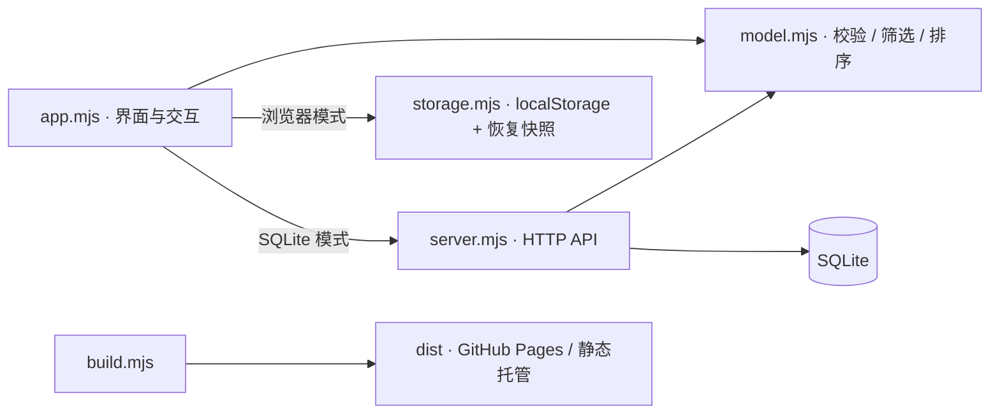

# Architecture

FlowBoard 有一个界面和两种明确的存储方式。浏览器与服务端共用数据校验，任务模型不依赖 DOM 或 SQLite。

## 模式选择

源码 HTML 默认声明 `flowboard-storage=browser`，因此 `dist/` 可在任何普通静态服务器和 GitHub Pages 子路径上运行。Node.js 完整服务返回 HTML 时把该标记改为 `sqlite`，浏览器再连接同源 API。`?storage=browser` / `?storage=sqlite` 可用于显式调试。

`npm run preview` 不创建数据库，也不提供任务 API。不同模式的数据不自动互相搬运，可用 JSON 备份导出、导入。

## 数据写入

SQLite 使用单行工作空间快照和递增 `revision`。更新语句要求 `WHERE revision = expectedRevision`，竞争写入只能有一项成功，其余收到 409；界面重新读取最新版本，提示用户重新编辑。

浏览器写入前先校验任务并保留一份已验证的旧快照。读取到损坏数据时不会静默重置；用户可以下载原始数据，或选择恢复旧快照。localStorage 没有跨标签页原子事务，`storage` 事件仅负责同步界面，不等价于多人实时协作。

## 备份与导入

v1 JSON 封装为 `{ app: "FlowBoard", version: 1, exportedAt, tasks }`，也接受旧版直接任务数组。未知版本会被拒绝。导入按 ID 合并，重复项使用导入内容，整个合并结果在写入前验证。单次备份最多 2 MB、单工作空间最多 500 项任务。

## 工程边界

- Node.js 自带 HTTP、SQLite 和测试运行器，无运行依赖。
- 静态服务只返回白名单资源，不暴露数据库、服务端源码或 Git 文件。
- 文本渲染前转义；写请求验证来源、内容类型和数据版本。
- 头像与负责人是演示角色。认证、共享工作空间、WebSocket 和附件不在当前版本内。

## 验证方式

`npm run verify` 依次检查模块语法、运行模型/存储/HTTP 集成测试、构建静态演示。测试使用内存或临时数据库和随机回环端口，不修改开发数据库。
